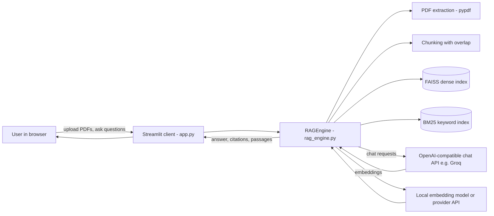
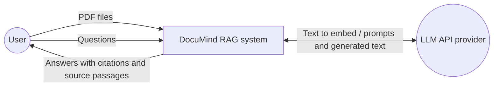
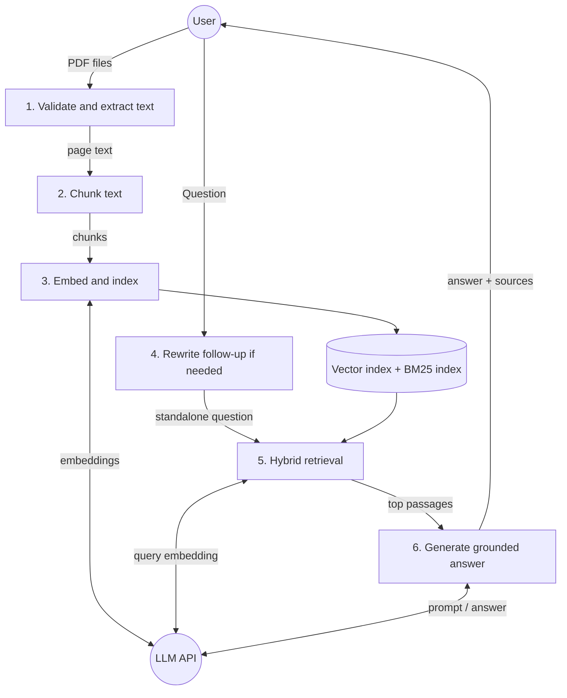
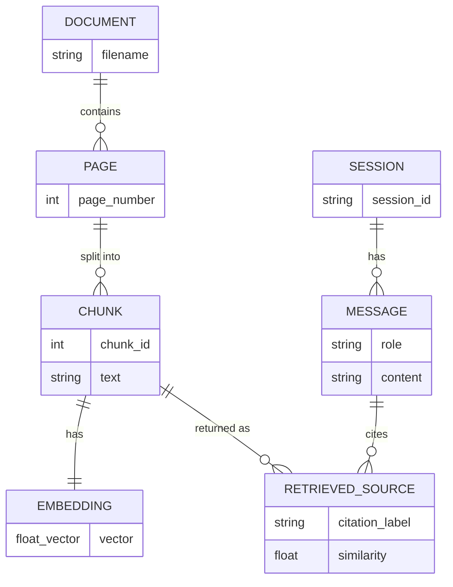

# Diagrams for the report

Paste each block into https://mermaid.live to render and export as PNG/SVG, or use any Mermaid-aware editor.
Note: DocuMind keeps its index in memory (no database), so the ER diagram below is a *logical data model* of what the
program holds while running. Say so in your report.

## 1. Client-server architecture

## 2. DFD level 0

## 3. DFD level 1

## 4. ER diagram (logical data model)

